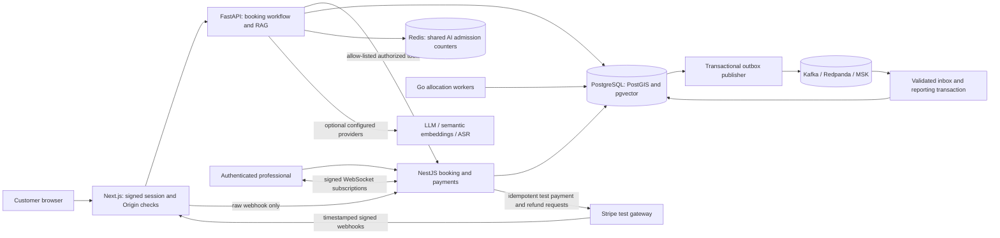

# Architecture and boundaries



PostgreSQL owns durable business state, conversation state, financial ledgers, event inboxes and retry schedules. Redis provides atomic per-actor admission counters across AI replicas in strict mode; it does not own booking or confirmation correctness. Outbox rows commit with their source transactions; the publisher acknowledges Kafka before marking publication. Retries may duplicate transport messages, but the consumer inbox and report updates commit atomically. The benchmark and replay tests demonstrate this behavior, without claiming globally exactly-once delivery.

```mermaid
sequenceDiagram
  participant C as Customer
  participant AI as AI workflow
  participant API as API
  participant DB as PostgreSQL
  participant G as Go allocator
  participant P as Professional
  C->>AI: Multilingual request or transcribed audio
  AI->>API: Resolve category and validate availability
  AI->>DB: Persist proposal
  AI-->>C: Ask explicit confirmation
  C->>AI: confirm
  AI->>DB: Lock conversation; persist executing intent and stable key
  AI->>API: Create booking using that same key on recovery
  API->>DB: Booking + idempotency result + outbox in transaction
  AI-->>C: Booking request reference, awaiting allocation
  G->>DB: SKIP LOCKED, PostGIS candidates, ETA and service radius
  G->>DB: Create expiring offer
  P->>API: Accept offer
  API->>DB: Serializable transition and exclusion constraint
  DB-->>API: Committed state notification
  API-->>C: WebSocket event; latest location available on reconnect
```

Identity is bound to signed expiring HS256 assessment credentials and tenant membership; roles come from `app_users`, never caller role headers. The trusted web/AI proxy has a separate service credential. Tokens are issued only by an authorized operator using `scripts/issue-token.mjs`; this is a functional assessment identity flow, not a supplied OIDC login UI. Production can replace the issuer with OIDC after issuer/JWKS validation is implemented and tested. The local `AUTH_MODE=demo` is explicit and ports bind to loopback.

AWS deployment uses separate database users for API, allocation, pipeline and AI, with an owner-only migration identity and a one-time privileged extension bootstrap. RAG identity lookup and audit/conversation/document access are granted to AI; booking/payment mutation permissions are not. The local demo shares a database owner credential for easy setup, so local isolation depends on application checks. No production isolation claim should be inferred from that demo.

AWS artifacts include three AZ network placement, Aurora replicas, encrypted Redis, MSK IAM/TLS, EKS workload identities, node/pod autoscaling, CloudWatch logging/metrics, TLS ingress, network policies, immutable image release, atomic migrations and rollback. Their configuration is locally validated; account provisioning, DNS/certificate validation, live rollouts and recovery drills remain account-dependent evidence. See [AWS deployment](aws-deployment.md) and [strict review](strict-review.md).
