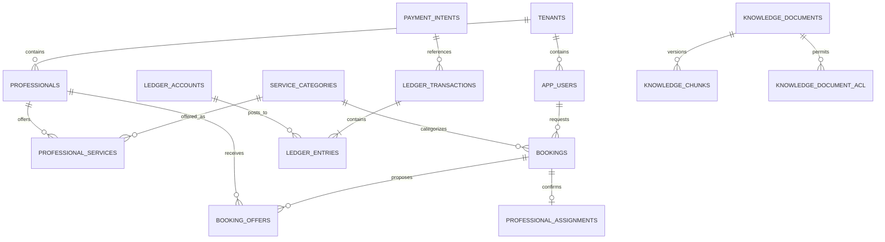

# Data model and invariants

## Invariants worth defending in a review

- One booking can have at most one pending offer. This is a partial unique index, not an application convention.
- One professional cannot have overlapping active assignments. PostgreSQL enforces this with a GiST exclusion constraint on half-open time ranges.
- A booking idempotency key is scoped by tenant, actor and operation. Reuse with a different request hash is a conflict.
- A webhook event is unique per gateway. Duplicate delivery returns success without a second state transition.
- Ledger rows cannot be updated or deleted. A posting is accepted only with non-empty equal debit and credit totals in one currency and one tenant.
- Pipeline effects and the consumer inbox payload identity marker commit in the same transaction; monetary aggregates are separated by currency.
- RAG retrieval joins only the active, non-deleted document version and applies ACL predicates before vector ranking.

## Partitioning path

At the stated average volume, a single regional writer is adequate; 2 million records/day averages roughly 23 records/second, though peak and replay traffic matter more than the average. Tables with unbounded growth (`booking_locations`, inbox/outbox, audit, ledger entries) should be monthly range-partitioned once measured retention volume warrants it. The next sharding key is tenant/service area because allocation is geographically local and financial reports already carry tenant identity.

## Added integrity schema

Migrations 004–006 add one payment intent per booking, durable webhook recovery, business refund deduplication, stronger ledger guards, durable AI conversations with PostgreSQL advisory locking, document encoder identity, inbox payload identity, DLQ publication/recovery state, and currency-specific reporting keys. Applied migration checksums are recorded; concurrent migration runners hold one advisory lock and commit each change with its migration record.

Conversation state survives Redis eviction and an AI process crash. Before a mutating tool call, `executing` state and the exact request/idempotency key are durable; an uncertain response recovers that same operation. RAG updates swap the active version under transaction locking, and deletion removes its documents, chunks and ACL entries together.
