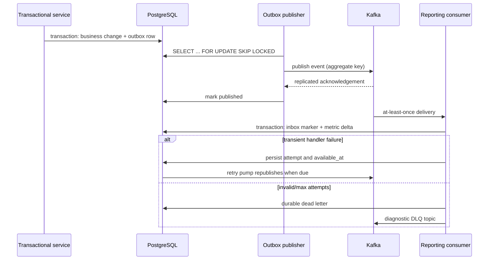
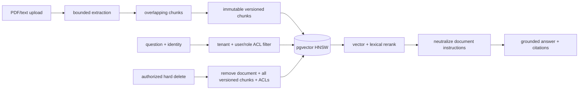

# Data flows

## Ingestion, retry and reporting



The potentially ambiguous crash window is after Kafka acknowledges and before `published_at` commits. That creates a duplicate, not a lost fact; the consumer inbox absorbs it.

## AI booking authority

```mermaid
stateDiagram-v2
  [*] --> Collecting
  Collecting --> Collecting: missing fields / clarify
  Collecting --> AwaitingConfirmation: typed availability tool succeeds
  AwaitingConfirmation --> AwaitingConfirmation: ambiguous reply
  AwaitingConfirmation --> Cancelled: user cancels
  AwaitingConfirmation --> Executing: exact explicit confirmation
  Executing --> Completed: backend transaction succeeds
  Executing --> Failed: timeout / response lost; outcome unknown
  Failed --> Executing: retry same immutable request and key
  Executing --> Collecting: definite backend rejection
```



The model cannot transition directly to `Completed`. It has no booking database credentials, and the idempotency key is derived server-side from the actor-bound conversation. Completed means the backend accepted the request; professional assignment remains a separate lifecycle. An interrupted executing checkpoint or a failed/uncertain response retains the immutable request and cannot be discarded by an edit or cancellation.

## Payment capture and replay

```mermaid
sequenceDiagram
  participant G as Gateway sandbox
  participant A as Payment API
  participant DB as PostgreSQL
  G->>A: signed captured event
  A->>A: constant-time signature check over raw bytes
  A->>DB: insert gateway/event ID
  alt duplicate ID
    DB-->>A: conflict
    A-->>G: success, duplicate=true
  else first delivery
    A->>DB: lock intent; post gateway debit + revenue/payable credits
    A->>DB: deferred balance constraint + state + outbox
    A-->>G: success
  end
```

## RAG update and query


