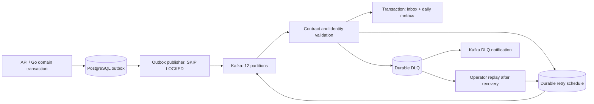

# Scenario 2 strict review and verification

## Review outcome

The original implementation did not meet the financial reporting/recovery requirement. It accepted arbitrary payloads, silently acknowledged missing bookings without updating reports, treated event-ID reuse with a different payload as a normal duplicate, mixed currencies, and converted bigint money into lossy JavaScript numbers. Duplicate failure deliveries raced when allocating retry attempts; dispatch marked future attempts as already delivered. Malformed JSON lost its original bytes. The only automated pipeline tests checked two pure helper functions.

These issues are corrected in contracts, pipeline code, and migration `006_pipeline_integrity.sql`:

- Known v1 event types and payload-specific UUID, amount, currency, timestamp, tenant and aggregate identity checks. Compatible extension fields remain supported. Unsafe JSON numbers are rejected; exact bigint strings remain exact in SQL.
- Inbox payload comparison and aggregation commit in one transaction. Concurrent duplicate deliveries produce one effect; changed payloads under an existing event ID enter DLQ. A missing booking retries; a cross-tenant/category reference is rejected without an inbox commit.
- UTC event-date count aggregates (`currency=XXX`) and monetary aggregates partitioned by actual currency. Refunds arriving before captures remain order independent. Query reports by currency; never sum money across currencies. Migration preserves count history and reconstructs legacy monetary history from processed outbox records.
- Retry messages carry the attempt number. Duplicate failures insert one retry for that attempt. The dispatcher marks only selected `(event_id, attempt)` rows. `SKIP LOCKED` supports multiple publishers. Original/retry deliveries remain at least once; inbox transactions make reporting effects effectively once for each stable event ID.
- PostgreSQL DLQ rows are durable before Kafka acknowledgement. DLQ publication retries independently. Malformed records retain their original text and use a stable ID derived from topic/partition/offset. Authorized operators can replay a repaired dependency through a database-backed CLI. An already processed payload conflict cannot be replayed as a new effect.
- Eight partition consumers, twelve topic partitions, transactional batches of 100 published events, bounded retries, clean termination, crash exit and dependency-aware health endpoints. A new consumer group starts from the earliest retained offset instead of dropping pre-existing events.
- MSK IAM uses TLS and renewable OAUTHBEARER tokens from the AWS credential provider chain. Set `KAFKA_AUTH_MODE=iam` and `AWS_REGION`; development defaults to the isolated plaintext Kafka endpoint. Implementation follows [AWS's JavaScript signer integration](https://github.com/aws/aws-msk-iam-sasl-signer-js).

## Data flow and interface



The ingestion interface is a Kafka v1 domain event: `id`, `type`, `schemaVersion:1`, `aggregateId`, `tenantId`, `occurredAt`, `traceId`, and typed `payload`. `packages/contracts/src/index.ts` is the executable specification. Booking facts reference the booking aggregate. Payment facts include payment ID, booking ID, positive exact minor units and uppercase ISO-style three-letter currency. Currency codes are syntactically validated; the payment API defines the accepted business currencies.

Readiness is `GET :8090/health/ready`; liveness is `GET :8090/health/live`. Readiness checks a running/heartbeating Kafka consumer plus PostgreSQL. Crash exits allow the container orchestrator to restart the worker. Topic creation and IAM policies are infrastructure responsibilities.

Example reporting query (counts are event-day activity, not a cohort conversion funnel):

```sql
SELECT day, category_id, currency,
       requested_count, completed_count, cancelled_count,
       gross_amount_minor, refund_amount_minor,
       gross_amount_minor - refund_amount_minor AS net_amount_minor
FROM daily_booking_metrics
WHERE tenant_id = $1 AND day >= $2 AND day < $3
ORDER BY day, category_id, currency;
```

## Reproduction

Unit/schema tests and compilation:

```sh
npm test -w @obbian/contracts
npm test -w @obbian/pipeline
npm run build -w @obbian/pipeline
```

Create a disposable PostgreSQL database with PostGIS/vector and apply migrations 001, 002, 003 and 006 (or all current migrations). It must have `test`, `review`, or `benchmark` in its name. Tests deliberately refuse the application database. Point these environment variables at that migrated scratch database:

```sh
PIPELINE_TEST_DATABASE_URL=postgres://.../pipeline_review npm run test:integration -w @obbian/pipeline
PIPELINE_BENCHMARK_DATABASE_URL=postgres://.../pipeline_review KAFKA_BROKERS=localhost:19092 node benchmarks/pipeline_load.mjs
```

The integration suite uses real PostgreSQL; only the Kafka send operation is injected for a deterministic broker-failure test. It checks concurrent duplicates, conflicting payloads, failed-parent rollback/recovery, tenant isolation, bigint/currency accuracy, retry scheduling races, future-attempt retention, publication failure recovery, explicit DLQ replay and malformed-record evidence retention.

The load harness runs the actual compiled worker against real PostgreSQL and Kafka, creates twelve-partition temporary topics, loads synthetic bookings and six domain facts per booking pair into the real outbox, waits for inbox/report completion, republishes 10% duplicates, then waits for committed Kafka offsets and verifies exact unchanged reports and zero DLQ records. It shuts down its worker and deletes its temporary topics; the dedicated database retains its synthetic records for inspection. The default run is 12,000 facts; `PIPELINE_BENCHMARK_RECORDS` accepts multiples of six for larger runs. Results are saved to `benchmarks/results/pipeline-latest.json`.

Operator replay uses deployment-authorized database credentials (no public replay endpoint):

```sh
DATABASE_URL=postgres://.../obbian npm run replay -w @obbian/pipeline -- EVENT_UUID
# In the production image (compiled CLI):
# node services/pipeline/dist/replay.js EVENT_UUID
```

Repair the underlying dependency first. Invalid schemas need a corrected source fact with a new event ID after investigation; the tool deliberately refuses an unparseable event and a conflicting payload for an already processed event. Inspect `dead_letters.replayed_at` and `recovered_at` to distinguish queued from successful recovery.

## Measured evidence and limits

See `benchmarks/results/pipeline-latest.json` for the measured run and exact aggregates. The benchmark reports equivalent records/day because 2,000,000/day is an average 23.15 records/second. Passing a short local run establishes demonstrated throughput above that average; it does not establish 24-hour durability, peak-load SLA, AWS performance, or multi-AZ disaster recovery.

Known operating limits: one PostgreSQL writer and a hot tenant/day/category aggregate row can serialize updates. The benchmark intentionally includes this hot-row workload. Scale by separating ingestion/reporting pools, increasing partitions only after measuring partition skew, and introducing sharded partial aggregates merged incrementally when row-lock wait dominates. Inbox/outbox/DLQ retention and archival require a deployment-specific retention policy; permanent deduplication is not compatible with deleting inbox history before the permitted replay window. Kafka retention must exceed the longest supported outage. Business producers must preserve stable event IDs on retries; the consumer does not infer semantic equivalence between different event UUIDs. Unavailable source parents exhaust a bounded retry budget and require operator recovery; there is no silent discard.

## Initial upgrade compatibility

Migration 006 replaces the reporting table's three-column primary key with a currency-aware key. The original pre-review pipeline image is therefore not a compatible rollback target after this migration. For that initial upgrade, stop the old reporting worker, apply the migration, and start the reviewed worker; the durable outbox/Kafka backlog is retained and consumed on recovery. New AWS deployments bootstrap directly to the reviewed schema. Subsequent rolling releases must use expand/contract migrations and only retain schema-compatible application images as rollback candidates. This one-time upgrade does not claim uninterrupted reporting availability.
